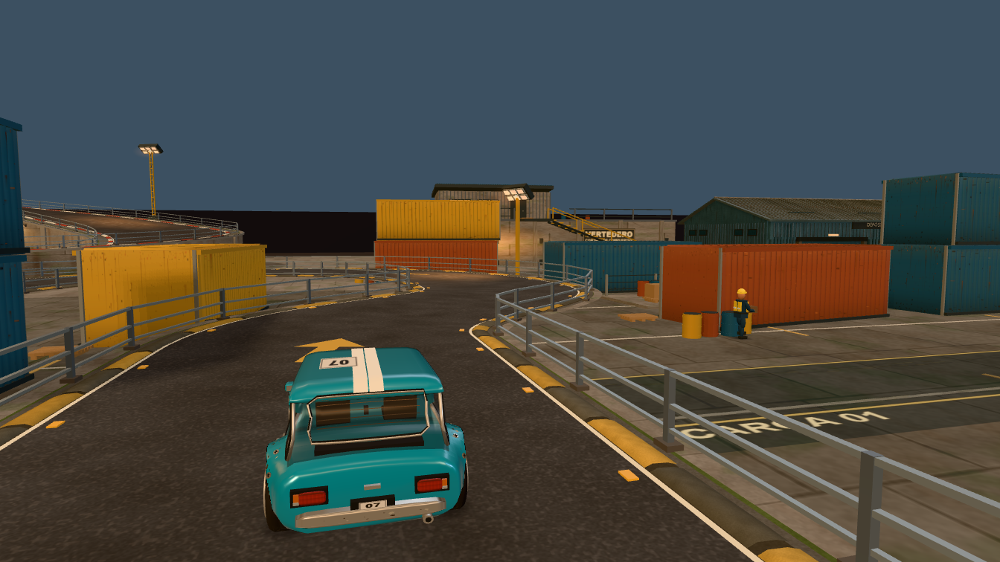
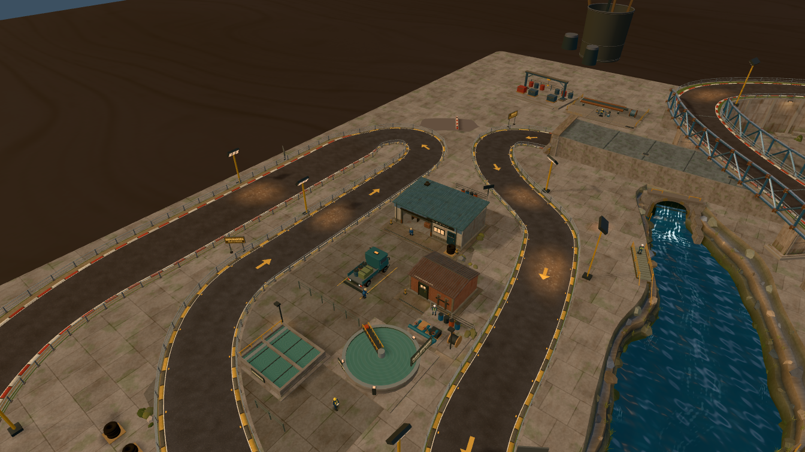
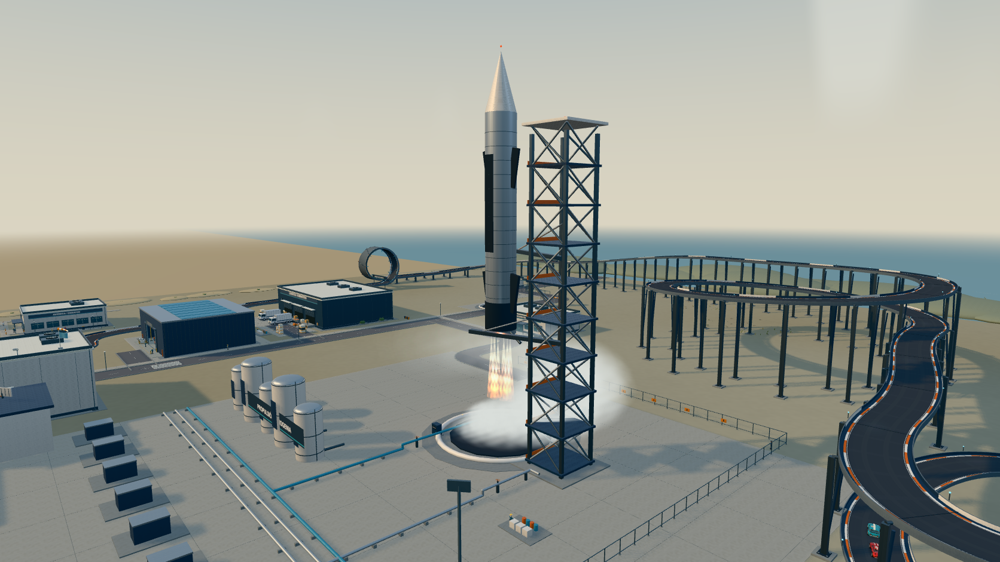

# Revisión conjunta: materiales, detalle, IA y despegue

Fecha: 16 de noviembre de 2026.

## Criterio visual

Taller 07 establece el criterio: esmalte con reflejos definidos, goma mate, acero legible, variación de rugosidad, uniones constructivas, contacto con el suelo y detalle que funciona desde cámaras bajas. Dique y SpaceX conservan sus ambientes portuario y costero. La comparación se hace por tamaño visible y función de cada pieza; no por repetir los objetos del taller ni por igualar el número de polígonos.

Se revisaron el recorrido de la terminal entre containers, planta de tratamiento, edificios, muelle y zonas de servicio del Dique; en SpaceX, plataforma, apoyos de las pistas elevadas, campus, instalaciones, superficies abiertas y vegetación costera. Se verificaron vistas diurnas/nocturnas y persecución, además de los mapas y materiales del primer circuito.

## Hallazgos y cambios aplicados

| Área | Hallazgo | Corrección |
|---|---|---|
| Modelos del Dique | La pátina de boxes, muros de muelle, embarcadero y edificios cambiaba principalmente el color. | Canales separados de relieve y rugosidad: poros, sal, humedad, desgaste de pintura y veta modifican también la respuesta a la luz. |
| Herrajes portuarios | Brillo y relieve dependían del mapa de color. | Datos lineales independientes, metal diferenciado y filtrado anisotrópico 8× para planos rasantes. |
| Pintura de SpaceX | Las superficies grandes se leían demasiado uniformes. | Capa de barniz moderada, desgaste fino, variación de brillo y suciedad localizada; el metal sigue usando rayas orientadas. |
| Hormigón y fachadas | Escasa diferenciación entre textura y suciedad. | Árido, poro, relieve y rugosidad calibrados. Se redujo una primera versión excesivamente contrastada al detectar repetición visible en los aprons. |
| Apoyos y puentes de SpaceX | Faltaban remates de escala pequeña en los pilares. | Placas de anclaje, arandelas y pernos; juntas finas en tramos elevados. Se mantienen fuera de los carriles y del gálibo de los cruces. |
| Contacto y volumen | Algunas piezas parecían desconectadas de su apoyo. | Oscurecimiento local precalculado en las piezas antes de agruparlas, compatible con objetos animados. |
| Suelo costero | Grandes claros con poco detalle a altura de auto. | Seis zonas de pastos secos y piedras pequeñas; separación respecto de trazado, vías de servicio y edificios. |
| Reflejos exteriores | El entorno reflejado era demasiado uniforme. | Variación de horizonte industrial en el mapa de entorno filtrado una sola vez. |

El agua animada, plantas acuáticas, trabajadores, grúa y carga portuaria existentes permanecen activos. También permanecen los laboratorios, reparaciones, rover, fotógrafos, seguridad y vehículos de servicio del espacial. Estas mejoras se apoyan en esas escenas habitadas y no reemplazan sus modelos con objetos más simples.

La revisión acerca el tratamiento de los materiales al criterio del Taller. No constituye una equivalencia visual del 100%: siguen siendo circuitos con distintas escalas, siluetas, iluminación y densidad de objetos.

## IA: diagnóstico de la captura de resultados

La captura mostraba mejores vueltas de bots alrededor de 3:14 frente a 2:21 del jugador. La simulación reprodujo el problema: el ritmo Club del espacial estaba limitado por objetivos de crucero anteriores a las mejoras de motores y caja. No era un atasco generalizado.

Se actualizó el objetivo de velocidad de Dique y SpaceX a partir de las constantes actuales de conducción, se equilibraron los cuatro modelos y se amplió el aprovechamiento de curvas de Pro en SpaceX. Se mantienen anticipación de frenadas, margen por superficie mojada, tráfico lateral, compromiso de adelantamiento y recuperación de orientación. La física, los cinco cambios y el plazo de llegada son los mismos que antes; no hay teletransporte, vueltas otorgadas ni motores especiales para bots.

Prueba reproducible: cuatro autos, tres vueltas, 60 pasos de simulación por segundo, tres dificultades, los tres circuitos. Se registran mejores vueltas, llegada, contactos, paradas y coste de simulación en [bots-2026-11-16.json](bots-2026-11-16.json).

| Circuito / dificultad | Mejor vuelta media anterior | Actual |
|---|---:|---:|
| Dique / Club | 1:50,43 | 1:25,12 |
| SpaceX / Rookie | 3:53,77 | 2:43,56 |
| SpaceX / Club | 3:11,82 | 2:24,17 |
| SpaceX / Pro | 2:44,05 | 2:22,98 |

Los cuatro autos terminan en las nueve combinaciones, sin reinicios de posición ni detenciones prolongadas. Taller conserva su ritmo previo. El coste p95 del paso de simulación observado fue aproximadamente 0,06–0,12 ms en esta máquina. Una regresión adicional conduce el Bólido con controles de un piloto Pro mientras los otros tres usan Club: los cuatro terminan la carrera de tres vueltas dentro del plazo real.

## Primer cambio de cámara

La auditoría detectó una pausa al usar persecución por primera vez en el Dique. La vista general no utiliza el mismo conjunto de luces directas ni el cristal detallado de los autos. Ahora se compilan y se dibujan esas variantes mientras continúa visible el logo de carga, antes de entrar a la carrera. Se conserva el material y la iluminación de la cámara cercana.

## Despegue

La plataforma espacial activa ascenso, fuego, humo y sonido por proximidad, con rearme a los 14 segundos y protección contra repeticiones en la misma vuelta. [Secuencia y capturas](spaceport/liftoff-review.md).

## Validación

173 pruebas automáticas aprobadas. Compilación TypeScript y builds LAN y GitHub Pages aprobados. La medición de render se realiza en Chrome, ANGLE/D3D11, RTX 3060 Ti; 1920×1080 individual y resolución interna adaptativa de 1536×864 con cuatro vistas. Las cifras corresponden a esa configuración y no certifican 60 fps en todos los móviles.

Doce escenarios de ocho segundos después del calentamiento: 60 fps en todos, sin fotogramas superiores a 25 ms dentro de las ventanas medidas. Se verificó también la recuperación del contexto WebGL en SpaceX. El audio activo utilizó el worker existente (78 buffers preparados).

| Circuito / escenario | Resolución interna | FPS | GPU p95 (ms) | Frame máximo (ms) |
|---|---|---:|---:|---:|
| SpaceX / overview | 1920x1080 | 60 | 6.82 | 16.9 |
| SpaceX / spiral-chase | 1920x1080 | 60 | 6.37 | 16.9 |
| SpaceX / night-split4 | 1536x864 | 60 | 12.57 | 16.9 |
| SpaceX / campus-chase | 1920x1080 | 60 | 10.44 | 17 |
| SpaceX / campus-night-split4 | 1536x864 | 60 | 10.31 | 17 |
| SpaceX / launch-approach | 1920x1080 | 60 | 6.24 | 16.9 |
| SpaceX / launch-night-split4 | 1536x864 | 60 | 8.67 | 16.9 |
| Dique / day-general | 1920x1080 | 60 | 9.39 | 16.9 |
| Dique / day-chase | 1920x1080 | 60 | 6.77 | 17 |
| Dique / night-split4 | 1536x864 | 60 | 9.57 | 16.9 |
| Dique / port-chase | 1920x1080 | 60 | 6.96 | 16.9 |
| Dique / day-river | 1920x1080 | 60 | 5.93 | 16.9 |

[Datos de rendimiento y audio](rendimiento-circuitos-2026-11-16.json).

