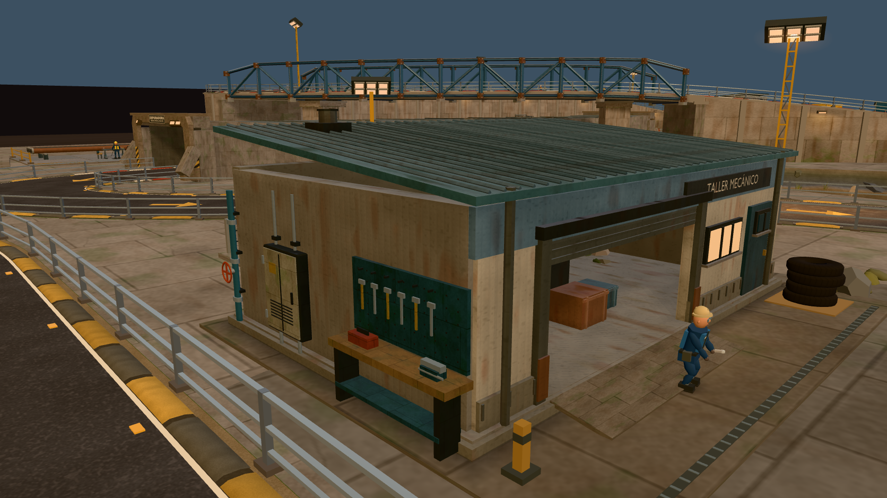
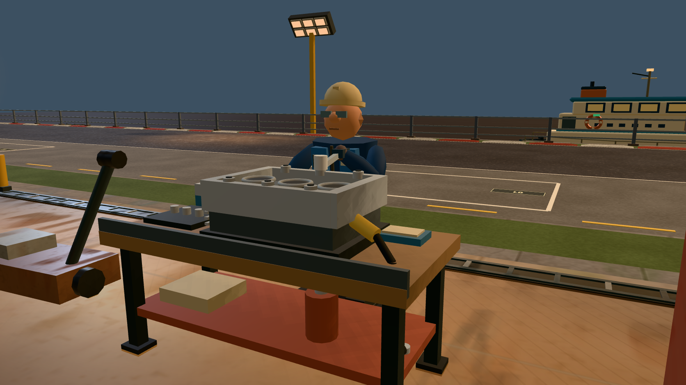
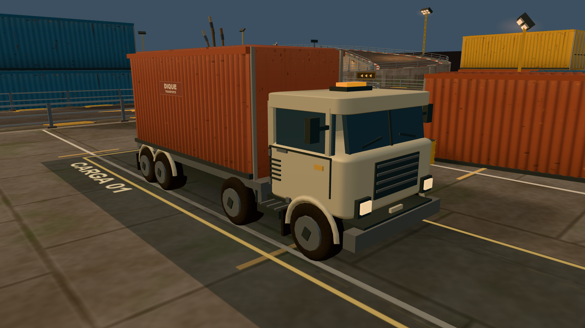
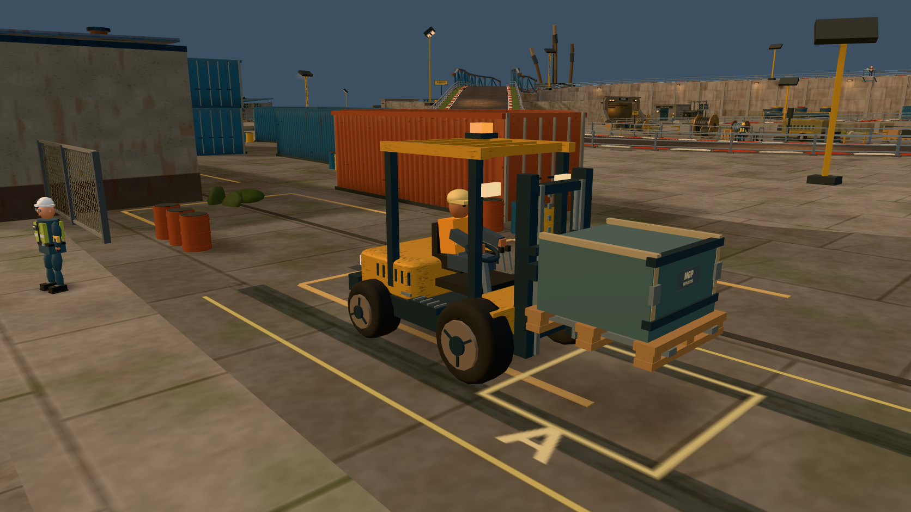
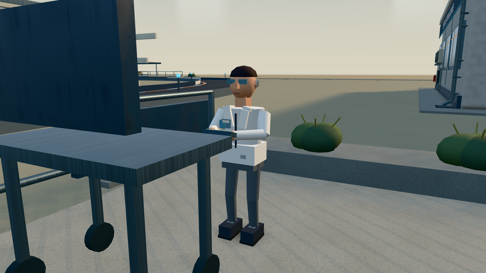
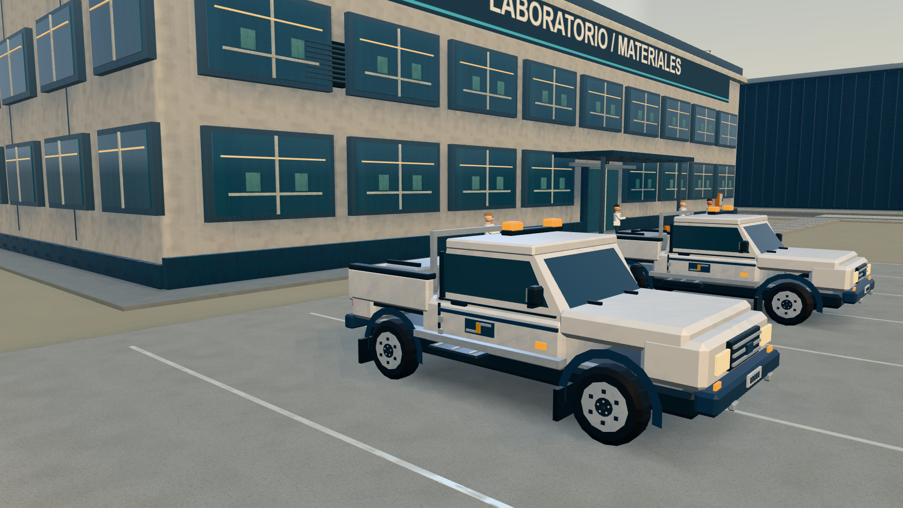
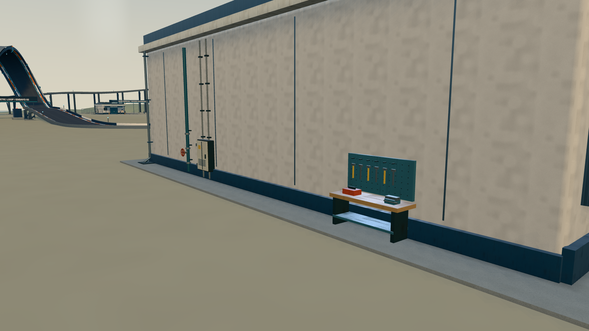
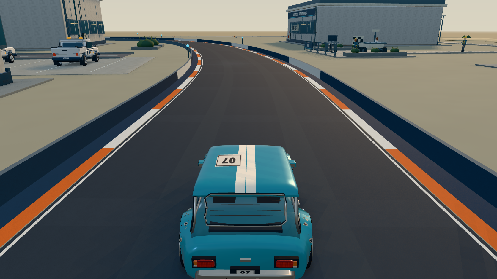

# Detalle de edificios, vehículos y personal en persecución

16 de noviembre de 2026. Revisión de Dique y SpaceX tomando como criterio la lectura de materiales y piezas pequeñas del Taller 07.

## Cambios realizados

- **Catorce edificios**: cinco del Dique y nueve del campus espacial. Instalaciones colocadas en los laterales de servicio, con armarios eléctricos, juntas, bisagras, cierres, rejillas, conductos sujetos con abrazaderas, tuberías con bridas y válvulas, condensadores con ventiladores y aletas, soportes y desagües. Escaleras de acceso al techo y equipos contra incendios sin tapar las entradas.
- **Mantenimiento visible**: banco y panel de herramientas en el taller del Dique y en aviónica e instrumentación. Mesa, estante, caja de herramientas y morsa. Se separó una válvula del banco después de la revisión visual.
- **Acabado**: biseles en volúmenes grandes del equipo, acero y esmalte separados, oclusión precalculada en caras inferiores y sombra suave alrededor del zócalo. Cristales del campus con capa de barniz para reflejos más definidos. No se agregaron luces ni pases de sombra por cada nuevo objeto.
- **Flota espacial en Blender**: tres modelos originales revisados; bisagras y juntas de puertas, estribos antideslizantes, luces laterales, faldones, fijaciones de caja, enganches, cierres del portón, neumáticos con hombros redondeados y dibujo. Mismos pivotes, rutas y agrupación de materiales. Vidrios con barniz y sombreado de los bajos incorporado al color de vértice.
- **Camiones del Dique**: juntas, bisagras, gomas de ventanilla, limpiaparabrisas, peldaños, rejillas, fijaciones de depósitos, guardabarros abiertos y faldones que acompañan al vehículo.
- **Montacargas del Dique**: cilindros y vástagos hidráulicos, guías de cadena, mangueras, ventilación del contrapeso, estribos, palancas y segundo brazo del conductor. Conserva su ciclo de carga, ruedas y horquillas móviles.
- **Personal**: rostros más redondeados con orejas, cascos, cuello, cierres, bolsillos, identificación, cinturones, gafas y suelas. Se conservan gestos, desplazamientos, uso de herramientas, fotografías y reacción al paso de los autos.

## Presupuestos y comprobaciones

- Cada instalación de fachada usa dos lotes opacos y una franja de contacto, con menos de 8.000 triángulos. Las pruebas controlan dimensiones, apoyo, datos finitos y límites de las bases existentes.
- La flota mantiene **14 llamadas de dibujo**, incluida la sombra de contacto compartida. Asset GLB: **700.592 bytes**, **13 mallas**, **8.514 triángulos**. Una flota de diez vehículos con todas sus ruedas suma **58.982 triángulos**, dentro del límite original de 60.000.
- Se verificaron ocho minutos de movimiento continuo, pausas, unión de rutas, pivotes de ruedas y normales externas del neumático.
- Los 74 personajes del sistema espacial siguen agrupados en ocho lotes. El presupuesto de ensayo para 55 personas de un mismo rol es menor a 45.000 triángulos en detalle y menor a 25.000 en modo compacto. Este último mantiene las siluetas anteriores para las vistas pequeñas. El cambio de calidad no añade materiales ni compilaciones de shader por personaje.
- Se revisaron capturas reales del motor: edificios de día y de noche, operarios, flota y persecución de ambos circuitos. Se corrigieron dos interferencias de colocación y la compatibilidad de la geometría biselada con los lotes estáticos.

## Alcance visual

Esta pasada mejora la construcción y los acabados visibles desde el auto. No equivale a un render fuera de línea ni incorpora path tracing. Los personajes mantienen la escala y simplificación de miniaturas. El sombreado solar de todo el circuito todavía tiene menor precisión que un render de estudio a corta distancia; no se declara equivalencia fotográfica del 100 %.

## Rendimiento medido

Chrome/ANGLE D3D11, NVIDIA RTX 3060 Ti, salida 1920 × 1080. Audio activo, 78 buffers preparados. Doce ventanas aisladas de ocho segundos después del calentamiento. Pantalla dividida conserva la resolución interna adaptativa existente de 1536 × 864.

| Circuito | Vista | FPS | GPU p95 (ms) | CPU p95 (ms) | Fotogramas >25 ms |
|---|---|---:|---:|---:|---:|
| spaceport | overview | 60 | 7.01 | 5.3 | 0 |
| spaceport | spiral-chase | 60 | 5.93 | 4.6 | 0 |
| spaceport | night-split4 | 60 | 8.83 | 7.3 | 0 |
| spaceport | campus-chase | 60 | 6.15 | 3.4 | 0 |
| spaceport | campus-night-split4 | 60 | 9.77 | 7.5 | 0 |
| spaceport | launch-approach | 60 | 5.84 | 3.8 | 0 |
| spaceport | launch-night-split4 | 60 | 9.15 | 7.9 | 0 |
| dique | day-general | 60 | 10.19 | 9.8 | 0 |
| dique | day-chase | 60 | 6.34 | 4.6 | 0 |
| dique | night-split4 | 60 | 13.34 | 13.4 | 0 |
| dique | port-chase | 60 | 7.82 | 5.4 | 0 |
| dique | day-river | 60 | 5.68 | 5.4 | 0 |

Todos los casos mantuvieron 60 fps; p95 de fotograma de 16,7–16,8 ms. Estos resultados describen el equipo y las ventanas medidas, no garantizan 60 fps en todo teléfono ni cubren la compilación inicial durante la pantalla de carga.

[Datos completos](detalle-persecucion-rendimiento-2026-11-16.json).

## Capturas del motor

## Verificación de entrega

- 174 pruebas automáticas pasan, incluidos capacidad de instancias, poses, cambio de detalle, recorrido de trabajadores y límites de fachadas.
- Compilaciones LAN y GitHub Pages completas.
- Prueba de navegador en la compilación Pages: carga de los tres circuitos, preferencias, giro de cámaras en sala, práctica, modo Arcade, conducción en persecución y retorno al menú; sin errores de consola ni recursos fallidos.
- La última revisión visual movió el peldaño del camión del Dique detrás de la rueda delantera; conserva geometría, materiales y coste de dibujo.
