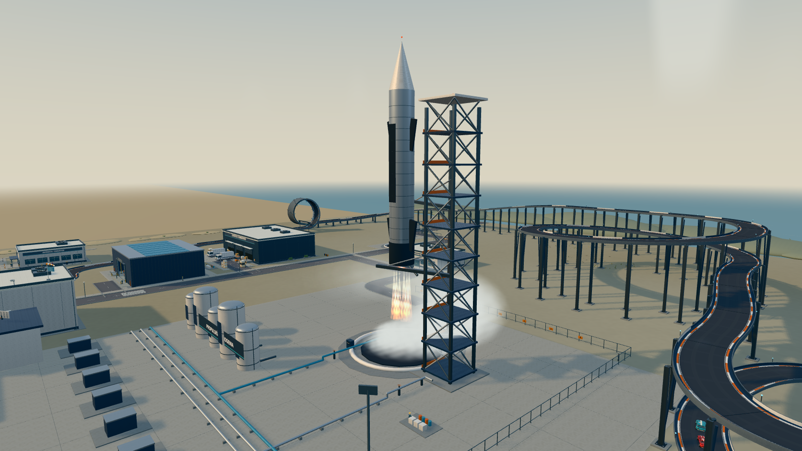
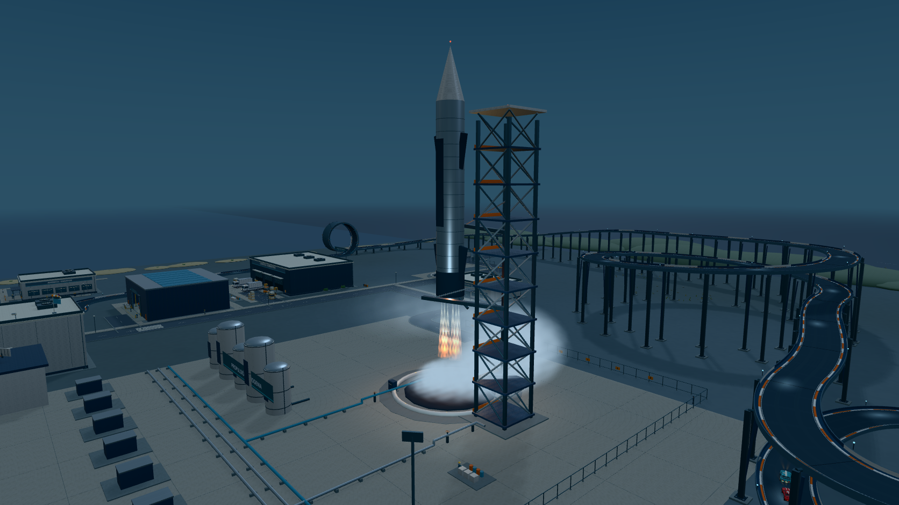
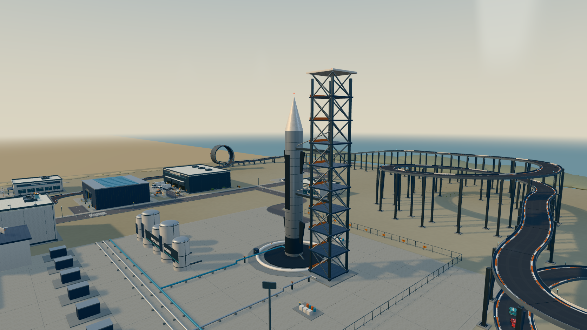

# SpaceX: despegue reutilizable

Revisión del 16 de noviembre de 2026. Capturas del renderizador del juego, no ilustraciones.

## Comportamiento

- Aproximación: la preparación empieza a 132 unidades de la plataforma. Al entrar en un radio tridimensional de 120, se activa el despegue; esta anticipación permite verlo al llegar con velocidad.
- Primeros 0,8 segundos: balizas, separación de brazos, vibración, encendido progresivo y nube en el suelo.
- Ascenso: aceleración vertical, seis escapes con gradiente cálido y turbulencia, brillo en las toberas y humo de estela. La luz local acompaña los motores; el reflejo del suelo disminuye con la altura.
- Salida: el vehículo se desvanece a gran altura, se despeja la plataforma y reaparece gradualmente entre el vapor. A los 14 segundos vuelve a estar listo.
- Cada plaza puede activar una vez por vuelta. Las pasadas posteriores por el ocho o la espiral no reinician la secuencia. Los jugadores que pasan juntos comparten el mismo lanzamiento.
- Los humanos tienen prioridad sobre los bots. En una exhibición sin humanos, los bots pueden activarlo. Resultados, grilla y cambio de carrera restablecen la plataforma.

## Sonido y recursos

Un único bucle procedural de cuatro segundos combina graves, rugido de banda media y pequeños crepitantes. Se genera en el worker de audio existente y se reproduce mediante un grafo reutilizado: fuente, filtro, ganancia y panorámica. No se crea otro AudioContext ni nuevos nodos por lanzamiento.

Se conecta al bus de **Efectos**, respeta silencio y volumen general, se atenúa y oscurece al alejarse, y se silencia en repeticiones y otros circuitos. La música y los niveles de motor permanecen con su configuración previa.

La prueba con OfflineAudioContext a 48 kHz verifica señal estéreo, panorámica, silencio final, volumen de efectos en cero y cambio de circuito. Con Efectos al 52% en esta prueba aislada, a 60 unidades: pico 0,0795, RMS 0,00718; a 700: RMS 0,00047. No hay saturación y la cola queda en silencio tras el rearme.

84 partículas reutilizadas, 42 en pantalla dividida de cuatro jugadores; no se crean geometrías, texturas o AudioNodes durante el ciclo. Los límites de visibilidad acompañan la altura. El cohete no se incluye en el mapa de sombras estáticas: una sombra de contacto local se desvanece al despegar, evitando una silueta congelada en el suelo.

## Verificación

Las pruebas cubren tres vueltas rápidas por el recorrido real, coche estacionado, pasadas simultáneas, prioridad humana, autos inactivos, cambio de sesión, relojes inválidos, ascenso y regreso, límites de visibilidad y reutilización de buffers. La prueba visual registra preparación, encendido, ascenso diurno/nocturno, despeje y plataforma nuevamente disponible.

La medición final de GPU y los resultados generales están en [la revisión conjunta](../calidad-circuitos-2026-11-16.md).

