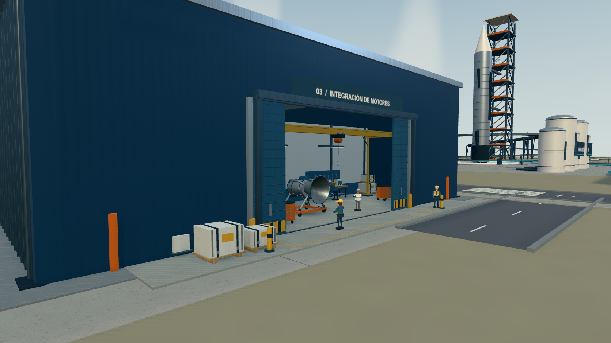
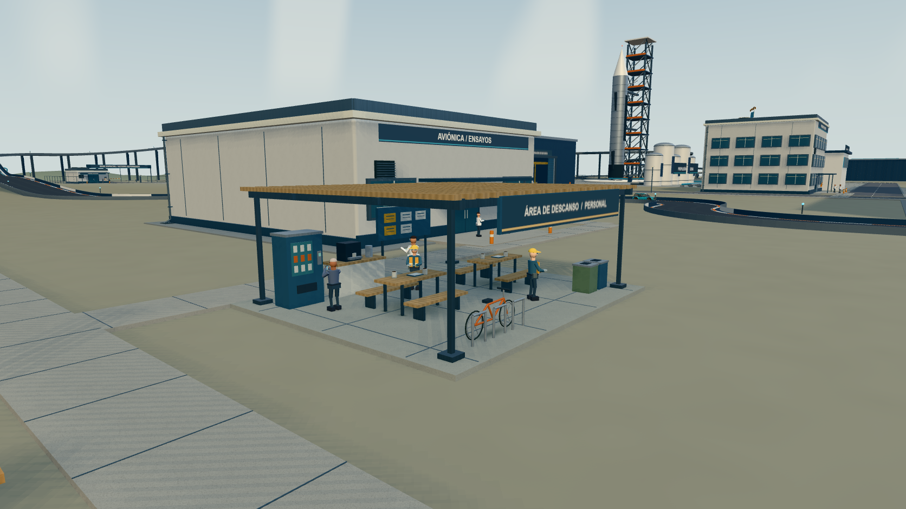
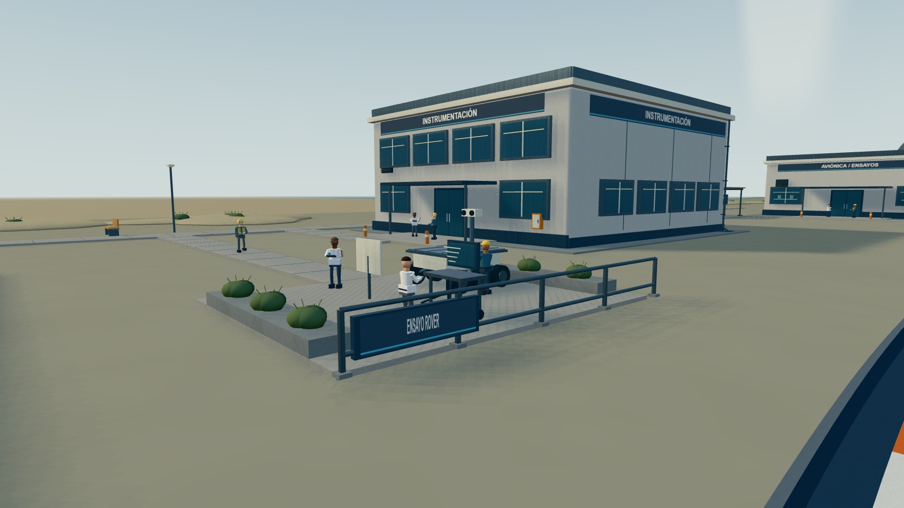
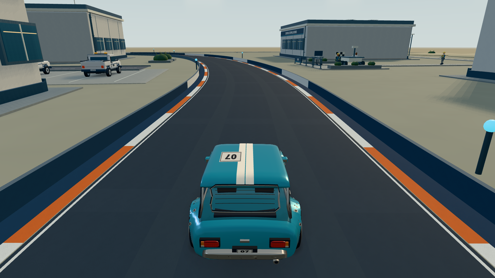
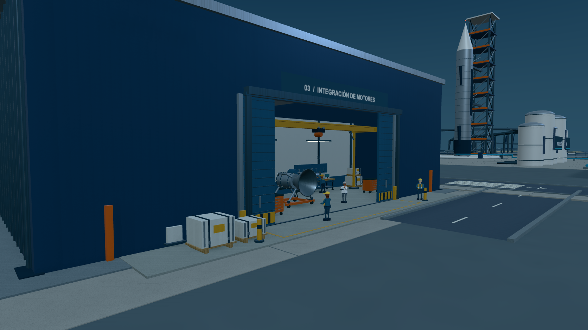

# Spaceport: materiales y espacios habitados

Revisión del 16 de noviembre de 2026. Las imágenes de este informe son capturas del motor del juego a 1672 × 941; no son renders conceptuales.

## Resultado visible

- El hangar occidental tiene una abertura real de 14 × 6,6 m. Se sustituyó el bloque cerrado por paredes, pilares, dintel y cubierta, conservando la implantación y las circulaciones.
- Taller de integración equipado: motor con campana hueca, soporte con ruedas, pórtico de grúa, mesas con piezas, paneles de herramientas, cajoneras, compresor y mangueras, escalera apoyada en el tabique, carretilla y embalajes flejados sobre pallets.
- Dos técnicos articulados trabajan sobre las piezas. El carro de la grúa recorre dos metros en unos 35 segundos; el cable permanece tenso y el gancho supera los tres metros de altura en un pasillo separado del motor y del personal.
- Patio del personal con pérgola, mesas, bancos, tazas, café, máquina expendedora, anuncios, recipientes de residuos, bicicleta y aparcabicicletas. Se conecta al sendero existente.
- Nuevo puesto de robótica junto a la calle del circuito: rover de seis ruedas, suspensión, panel solar, cámara, blanco de calibración, carro de diagnóstico y cable conectado al vehículo. Se ve durante la conducción.
- 74 personas en el sistema de personajes compartido, dos técnicos específicos de reparación y un conductor de autoelevador: **77 personas**. Hay doce personas compartidas más que en la versión anterior, además de los dos técnicos nuevos.
- Fachadas con zócalos, juntas de paneles, bajantes con abrazaderas, desagües, rejillas, armarios de emergencia y paneles solares con apoyos que siguen su inclinación. Los laterales de los hangares tienen nervaduras y canalizaciones.

## Materiales e iluminación

Se separaron los acabados de hormigón, revoque, chapa pintada, acero cepillado, madera, goma, vidrio y asfalto. Hormigón, revoque, chapa, acero, madera y asfalto usan mapas procedurales deterministas de 256² para color, relieve y rugosidad; goma y vidrio usan materiales específicos. El color se interpreta en sRGB y los mapas de datos permanecen lineales, con la rugosidad en el canal verde.

Las UV mantienen escala espacial. Los mapas repiten con mipmaps y filtrado anisotrópico; el relieve es discreto para evitar centelleos a distancia. En la revisión se eliminó un patrón de rombos producido por el ruido inicial. La madera conserva una veta longitudinal y el acero un cepillado fino.

La base utiliza ahora una sonda exterior de cielo y suelo, prefiltrada con PMREM una vez y reutilizada. La sonda se regenera tras recuperar el contexto WebGL. Taller y Dique conservan su entorno anterior. No se añadieron capturas de reflejos ni pases de ray tracing por fotograma.

Se amplió el volumen de sombras para incluir los edificios occidentales. Los objetos del taller y patio incorporan contactos suaves en un único lote transparente, incluyendo apoyos sobre mesas. Las luminarias tienen soporte físico y mantienen su lectura nocturna sin introducir nuevas luces dinámicas por objeto.

## Coherencia y revisión crítica

El acceso del hangar termina antes del camino de camiones. La grúa no levanta el motor mientras permanece apoyado. Herramientas, piezas y mesas están al alcance de los técnicos; sus cuatro pies tocan el suelo durante toda la animación. Los nuevos peatones no atraviesan la pista ni el acceso de servicio. Las instalaciones del rover quedan separadas del trazado y se accede desde el paseo occidental.

La revisión independiente detectó y corrigió falta de contacto visual, un cartel que ocultaba el rover, plantas enterradas en sus jardineras, un extremo de cable sin conectar y apoyos solares que no coincidían con el plano inclinado. Las capturas finales muestran esos ajustes. Se conserva la estética de miniaturas y geometría estilizada; no se presenta el resultado como fotorrealismo.

## Presupuesto y verificación

El módulo completo de taller y patio añade **22 llamadas de dibujo en el pase principal y 16.058 triángulos**, incluyendo técnicos, grúa, carteles y contactos. Las superficies se agrupan por material y las piezas mayores también por zona. No se añadió ninguna luz dinámica en ese módulo.

- 161 pruebas automáticas superadas y compilaciones LAN y GitHub Pages correctas.
- Cuatro pruebas nuevas cubren presupuesto de geometría e instancias, separación de pista y servicio, recorrido continuo del carro de la grúa y contacto de los pies con el suelo.
- Capturas diurnas y nocturnas desde conducción, campus, taller, patio, robótica y vistas generales, sin errores de consola.
- Prueba del build de Pages: selección de los tres circuitos, vueltas iniciales y guardadas, rotación de las cuatro cámaras cada cuatro segundos, partida Arcade, práctica, conducción y regreso al menú. Sin errores de navegador ni recursos ausentes.
- La medición reproducible y los datos anteriores se conservan en `materials-workplaces-performance.json`.

El perfil usa Chrome/ANGLE D3D11 sobre una NVIDIA RTX 3060 Ti, salida 1920 × 1080 y calidad Adaptativa. Las vistas individuales se miden a resolución interna 1920 × 1080; cuatro paneles nocturnos usan 1536 × 864. Cada caso tiene ocho segundos de medición tras calentamiento. El tiempo GPU se obtiene mediante consultas del temporizador WebGL. Estos resultados describen ese equipo y esa muestra; no certifican 60 FPS en cualquier dispositivo.

| Escenario | Resolución interna | FPS | GPU p95 | CPU p95 | Cuadros >25 ms |
|---|---|---:|---:|---:|---:|
| overview | 1920x1080 | 60 | 7.02 ms | 4.9 ms | 0 |
| spiral-chase | 1920x1080 | 60 | 7.52 ms | 5 ms | 0 |
| night-split4 | 1536x864 | 60 | 7.13 ms | 4.8 ms | 0 |
| campus-chase | 1920x1080 | 60 | 6.88 ms | 4.7 ms | 0 |
| campus-night-split4 | 1536x864 | 60 | 6.59 ms | 4.9 ms | 0 |

Los cinco casos mantuvieron 60 FPS, sin cuadros superiores a 25 ms durante las muestras. Se verificó también la pérdida y recuperación deliberada del contexto WebGL: la escena volvió a funcionar sin errores de consola.
