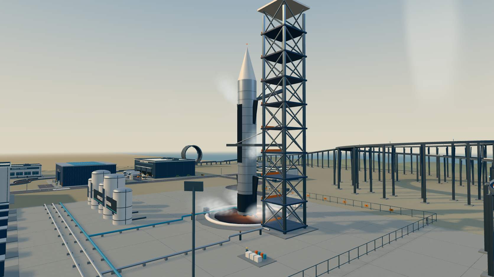
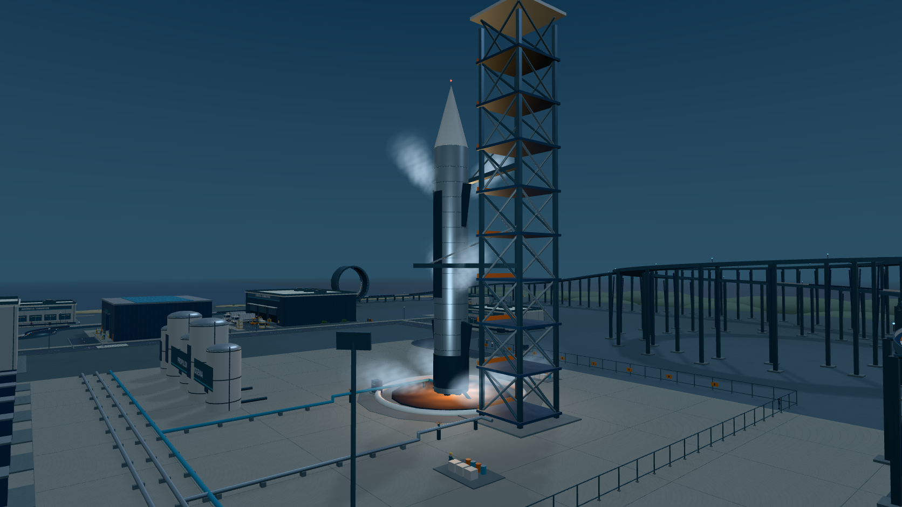
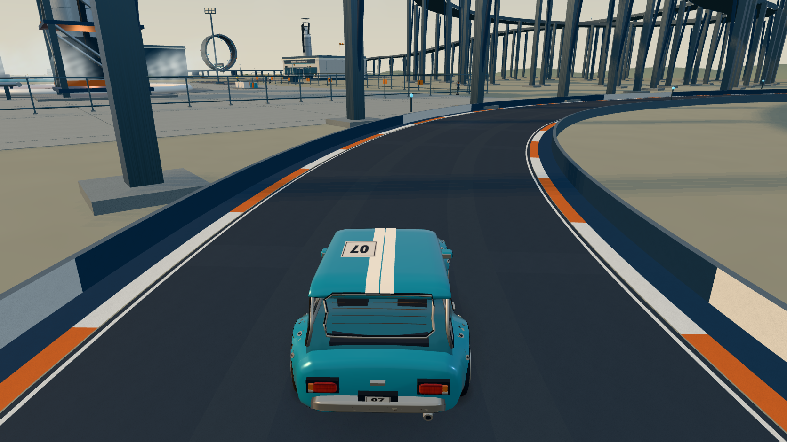

# Spaceport: iluminación y preparación de despegue

16 de noviembre de 2026. Capturas del juego a 1672 × 941.

## Comportamiento

El cohete principal reacciona a la distancia tridimensional de los jugadores respecto de la plataforma. La anticipación comienza dentro de 132 unidades y alcanza su objetivo máximo a 62; el paso más próximo del trazado está a unas 60 unidades. Las pruebas recorren ese sector a 65 unidades por segundo y comprueban que el efecto sea visible antes del paso cercano.

La aproximación aumenta progresivamente el venteo criogénico, activa las balizas, retira ambos brazos umbilicales y muestra un ensayo de encendido en seis motores. El fuselaje vibra suavemente y el resplandor colorea la plataforma. El cohete conserva su altura de apoyo: la escena representa los instantes previos al despegue.

El efecto mantiene brevemente su intensidad tras un paso rápido y disminuye al alejarse. No cambia las fuerzas del auto ni mueve la cámara. Las nubes permanecen junto a la plataforma, fuera del corredor de carrera. Cuando hay humanos, los bots alejados de ellos no pueden activar el espectáculo por su cuenta. En una demostración sin jugadores pueden activarlo los autos de exhibición. Una nueva partida reinicia la preparación y la pantalla de resultados la apaga suavemente.

## Iluminación

- Luz solar más cálida y lateral, con relleno frío moderado para dar volumen al metal y a los autos.
- Sonda exterior y brillo del cielo orientados como el sol. Horizonte diurno más cálido.
- Menor relleno general nocturno para que las lámparas, ventanas y motores tengan contraste.
- Dos reflectores físicos de seis lentes, orientados hacia la plataforma y el cuerpo del cohete, con iluminación directa sin sombras adicionales.
- Iluminación suave precalculada sobre pista, boxes, taller y patio. Las manchas de pista son mallas segmentadas que siguen la curva tridimensional, evitando planos flotantes en loops y pendientes.
- Resplandor local variable en los motores, más intenso de noche, con una única luz puntual sin sombras.

## Implementación y presupuesto

La secuencia visual está separada del renderizador y se alimenta de los snapshots existentes. No modifica protocolo, controles, trazado ni reglas de carrera. Sus tiempos se integran con un delta acotado para tolerar pestañas suspendidas y datos inválidos.

El vapor utiliza 84 partículas reutilizadas en una sola llamada de dibujo, reducidas a 42 con detalle reducido. Los planos orientan su cara utilizando la cámara de cada vista, de modo que también funcionan en pantalla dividida. No se crean texturas ni atributos durante la animación. Los seis motores, las bocas y las balizas se dibujan por instancias. La iluminación suave de suelo se combina en una malla.

Se mantiene una única sombra general precalculada del escenario. Los brazos móviles no se incluyen en esa caché, evitando una sombra inmóvil después de retraerse. No se añadieron pases de reflejos, bloom ni ray tracing. La plataforma sigue inmóvil mientras se anima únicamente el fuselaje y los brazos.

## Comprobaciones

- 166 pruebas automáticas superadas, incluyendo cinco nuevas para aproximación a alta velocidad, prioridad multijugador, apagado/reinicio, buffers acotados y ajuste de luces a la superficie tridimensional.
- Compilaciones LAN y GitHub Pages correctas.
- Revisión visual diurna/nocturna, preparación inactiva/activa y cámara de conducción, sin errores de consola.
- Prueba del build de Pages superada: tres circuitos, preferencias de vueltas, cuatro cámaras de sala, Arcade, práctica, conducción y regreso al menú.
- Los datos de tiempo de cuadro, CPU, GPU y resolución interna se conservan en `prelaunch-performance.json`.

El perfil se mide en Chrome, ANGLE D3D11 y NVIDIA RTX 3060 Ti, con salida 1920 × 1080 y calidad Adaptativa. Cada caso dura ocho segundos después del calentamiento. Las vistas individuales usan resolución interna 1920 × 1080 y las cuatro cámaras nocturnas 1536 × 864. Los valores describen ese equipo y esas muestras; no garantizan el mismo rendimiento en cualquier teléfono o GPU.

| Escenario | FPS | GPU p95 | CPU p95 | Cuadros >25 ms |
|---|---:|---:|---:|---:|
| overview | 60 | 7.94 ms | 4.8 ms | 0 |
| spiral-chase | 60 | 6.52 ms | 4.9 ms | 0 |
| night-split4 | 60 | 7.31 ms | 5 ms | 0 |
| campus-chase | 60 | 7.4 ms | 5 ms | 0 |
| campus-night-split4 | 60 | 6.55 ms | 6 ms | 0 |
| launch-approach | 60 | 6.9 ms | 4.8 ms | 0 |
| launch-night-split4 | 60 | 8.58 ms | 5 ms | 0 |

Los siete escenarios mantuvieron 60 FPS. También se provocó una pérdida de contexto WebGL y se verificó la restauración de la escena, sus efectos y la cámara sin errores de consola.
